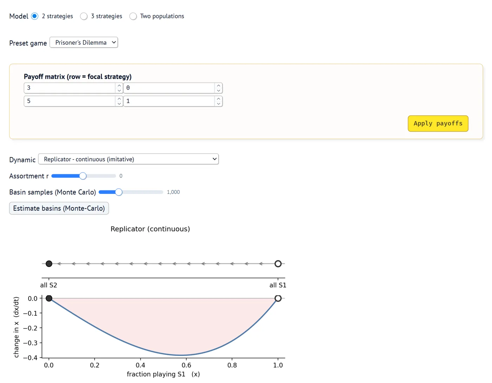
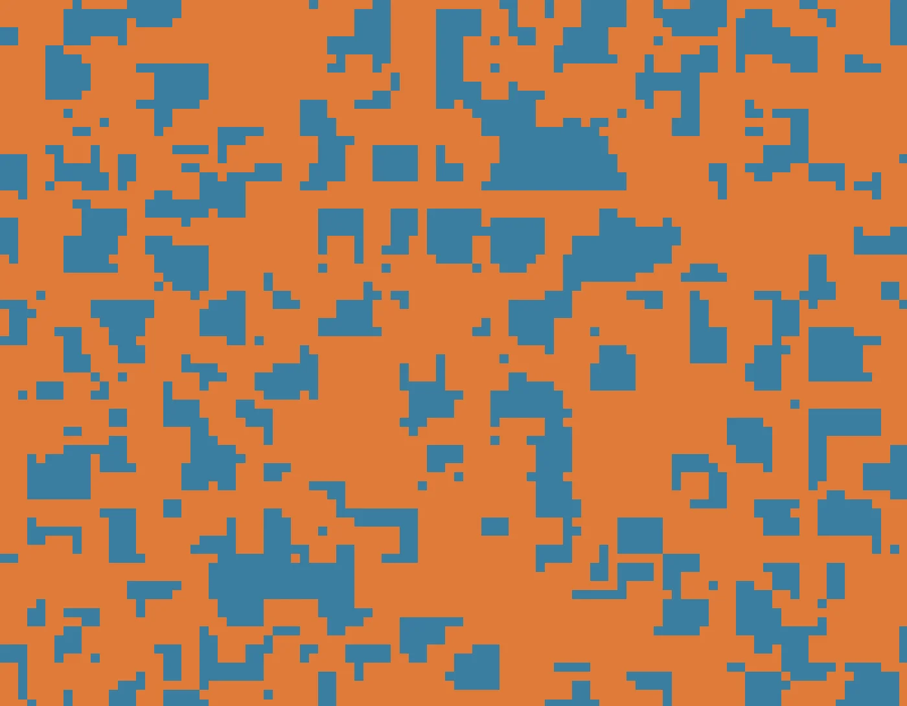

# PHIL 2001 course tools

The simulation tools for <em>Ethics and Evolutionary Games</em>, in one place.
They run in your browser on a laptop or a phone, with nothing to install. The first load
can take a minute while Python starts in the page.

## Which tool do I need? { #which-tool }

| I want to… | Use |
|---|---|
| see how a population's mix of strategies changes over time | [Replicator Explorer](#replicator) |
| check whether an equilibrium is stable, or how big its basin of attraction is | [Replicator Explorer](#replicator) |
| put players on a grid, have each one play only its neighbours, and watch strategies spread | [Spatial Explorer](#spatial) |
| read or change the Python code behind a model | [Class code](#class-code), or the Colab link on each tool |

## The tools { #tools }

<section class="tool" id="replicator" markdown>

### Replicator Dynamics Explorer

Shows how a population's mix of strategies changes when the strategies that do better
spread. It draws the phase portrait for 2-strategy games, 3-strategy games on the simplex,
and games between two populations. You can also add assortment and compare six dynamics.

**Try this.** Pick *Prisoner's Dilemma*, then drag the *Assortment r* slider past 0.5.
Once cooperators mostly meet other cooperators, all-cooperate becomes stable.

[Open the Replicator Explorer](https://rorysmead.github.io/phil2001-replicator/){ .md-button .md-button--primary }

 or <a href="https://github.com/rorysmead/phil2001-replicator">see it on GitHub</a>.

<figure class="tool-shot">
  
  <figcaption>Prisoner’s Dilemma with no assortment. Every path leads to all-defect.</figcaption>
</figure>
</section>

<section class="tool" id="spatial" markdown>

### Spatial Evolution Explorer

Players sit on a grid and play only their neighbours. Each round they copy or switch
strategies by an update rule you choose, and you watch strategies cluster, spread or die
out. It has presets from the readings, including the Prisoner's Dilemma, Stag Hunt,
Hawk-Dove, Nash demand and Lewis signalling, and you can share a run by its link.

**Try this.** Under *Load a preset*, choose *Prisoner's Dilemma - Nowak & May (b=1.85)*
and press Play. Cooperation dies out. Now tick *Play against yourself too*, as Nowak and
May did, and cooperators hold on at about 30%.

[Open the Spatial Explorer](https://rorysmead.github.io/phil2001-spatial/){ .md-button .md-button--primary }

 or <a href="https://github.com/rorysmead/phil2001-spatial">see it on GitHub</a>.

<figure class="tool-shot">
  
  <figcaption>Nowak &amp; May with self-play on, after 150 generations. 31% still cooperate.</figcaption>
</figure>
</section>

## More resources { #more }

- **Class Slack** 
  Where the class project is organised. Join with your @northeastern.edu email.
  [Join the class Slack](https://join.slack.com/t/ethicsandevol-t9t5805/shared_invite/zt-4ayaznr0m-ySVsedIYr2STxCtHrn3yvA)
- **Class code** 
  The class's Python notebooks for game-theory simulations.
  [rorysmead/GameTheory on GitHub](https://github.com/rorysmead/GameTheory)
- **NetLogo** 
  A free program for building agent-based models. You download it; it doesn't run in the browser.
  [NetLogo home page](https://ccl.northwestern.edu/netlogo/)
- **GenLab** 
  The spatial simulator used in earlier years. The Spatial Explorer replaces it.
  [Open GenLab](https://chessmyers.github.io/GenLab/)
- **3-strategy Simplex Mapper** 
  A desktop program that needs Java. Download it from Canvas under *Modules*, then
  *Computer and Modeling Resources*.

